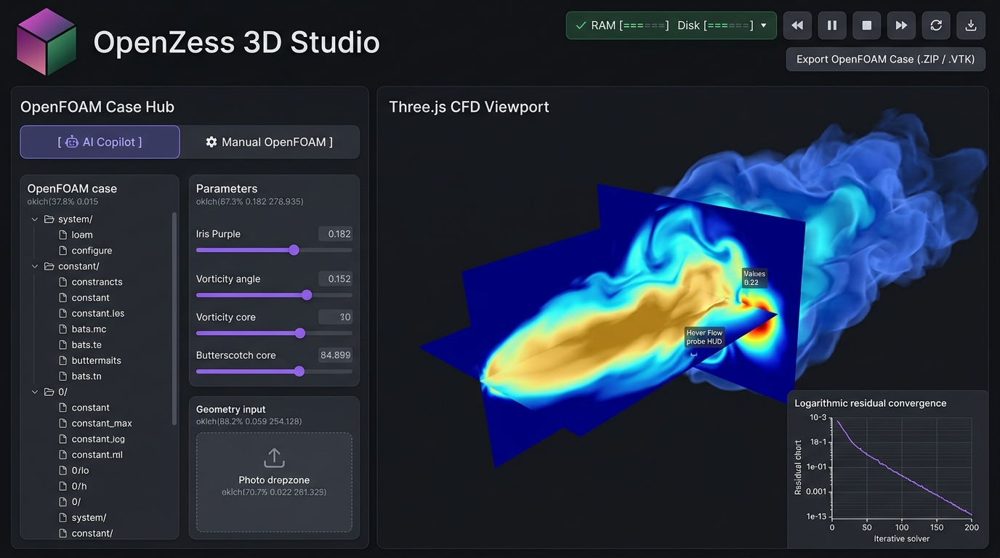
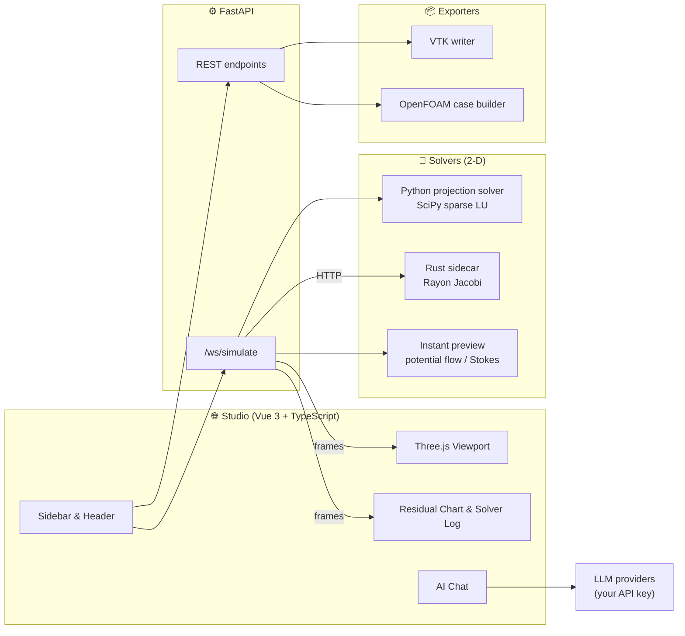

<div align="center">

# ⚡ OpenZess Studio

### A 2-D CFD Studio in the Browser

**Live Navier–Stokes solver · Instant potential-flow preview · Three.js visualization · OpenFOAM & ParaView export**

[](https://www.rust-lang.org/)
[](https://www.python.org/)
[](https://fastapi.tiangolo.com/)
[](https://vuejs.org/)
[](https://threejs.org/)
[](https://www.typescriptlang.org/)
[](LICENSE)

</div>

---

OpenZess Studio is a **2-D incompressible CFD studio inspired by [OpenFOAM](https://www.openfoam.com/)**.
A Python projection solver (SciPy sparse LU) streams live flow fields over a WebSocket to a
**Vue 3 + Three.js** studio, alongside an optional multi-threaded Rust kernel and an instant
potential-flow preview. Cases can be exported as ParaView `.vtk` files and edited through
OpenFOAM-style dictionaries. Everything runs locally.

<div align="center">
  
</div>

---

## ✨ Features

|     | Feature                | Description                                                                                                         |
| --- | ---------------------- | ------------------------------------------------------------------------------------------------------------------- |
| 🌊  | **Live CFD solver**    | Fractional-step incompressible Navier–Stokes, pressure Poisson by sparse LU, frames streamed live                   |
| ⚡  | **Instant preview**    | One sparse solve: inviscid potential flow around the body, or the Stokes solution for the cavity. *Not* an ML model |
| 🦀  | **Rust kernel**        | Optional sidecar; explicit solver with Rayon-parallel Jacobi pressure sweeps on large grids                         |
| 🔥  | **Thermal buoyancy**   | Boussinesq plume driven by the temperature slider; heavy-fluid gravity current for the dam case                    |
| 🧩  | **Custom geometry**    | Circle / square / rectangle / NACA airfoil placed with position, size and angle of attack                           |
| 🌌  | **3-D viewport**       | The 2-D solution on its section plane, the simulated body extruded along the span, particles, glyphs, live probe    |
| 📈  | **Residual monitor**   | Log-scale convergence plot and a solver log of real per-frame values (residual, Courant, continuity, Cd, Cl)       |
| 🎛️  | **Dictionary editor**  | Edit `deltaT`, `nu` and inlet velocity in OpenFOAM-style dictionaries and re-run                                    |
| 💾  | **Snapshots**          | Save / load the full case (physics, geometry, dictionary edits) on the server, with a browser fallback              |
| 🧊  | **ParaView export**    | Legacy `.vtk` (cell-centred velocity and pressure) of the last run                                                 |
| 📦  | **OpenFOAM export**    | Runnable `icoFoam` lid-driven-cavity case (`blockMesh` + `icoFoam`) with your Re, dt and grid*                      |
| 🤖  | **AI co-pilot chat**   | Ask an LLM (Gemini, OpenAI, Claude, DeepSeek, Groq, Ollama) using your own API key                                  |

\* Other geometries are not exported to OpenFOAM yet.

---

## 🚀 Quick Start

### Prerequisites

- **Python 3.10+**
- **Node.js 18+**: the launcher builds the frontend on first run
- **Rust (stable)**: optional, only for the Rust engine

### Run

```bash
pip install -r requirements.txt
python main.py
```

`main.py` builds `frontend/dist` if it is missing or older than the sources, starts the Rust
sidecar if you have compiled it, then serves the studio at
[`http://localhost:8000/studio/index.html`](http://localhost:8000/studio/index.html) and
opens your browser. Options: `--port`, `--no-browser`, `--reload` (development),
`--skip-build`. On Windows you can double-click `LAUNCH_STUDIO.bat`.

Optional Rust engine:

```bash
cd rust-sidecar && cargo build --release
```

### Frontend development (hot reload)

```bash
python main.py --no-browser      # terminal 1: backend on :8000
cd frontend && npm ci && npm run dev   # terminal 2: Vite on :5173
```

### Tests

```bash
pip install -r requirements-dev.txt && python -m pytest
cd rust-sidecar && cargo test
cd frontend && npm ci && npm run build   # vue-tsc type check + bundle
```

CI runs all three on every push (`.github/workflows/ci.yml`).

---

## 🖥️ Usage

1. **Pick a case**: airfoil, cylinder, F1 wing, drone, submarine, venturi, plume, dam
   break, lid-driven cavity, or build your own shape.
2. **Pick an engine**: Python (live frames), Rust (single result, needs the sidecar), or the
   instant preview.
3. **Adjust physics**: inlet speed, angle of attack, Reynolds number, fluid, gravity,
   heater temperature. Changes re-run automatically.
4. **Inspect**: hover the viewport for probe values; switch the field between |U|, p, T,
   vorticity and Q-criterion; watch residuals and the solver log.
5. **Export**: `.vtk` for ParaView, or the OpenFOAM case ZIP.

---

## 🔌 API Reference

| Endpoint                        | Method       | Purpose                                                   |
| ------------------------------- | ------------ | --------------------------------------------------------- |
| `/ws/simulate`                  | WebSocket    | Run a case; streams frames (fields, residual, forces)    |
| `/api/health`                   | GET          | Server status                                             |
| `/api/engine/status`            | GET          | Available engines, whether the Rust sidecar is online     |
| `/api/engine/benchmark`         | GET          | Rust kernel throughput (if the sidecar is running)        |
| `/api/system`                   | GET          | Host CPU count, memory and disk (for the header widget)   |
| `/api/projects`                 | GET / DELETE | List / delete saved snapshots                             |
| `/api/projects/save`            | POST         | Save a snapshot `{name, state}`                           |
| `/api/projects/load?name=`      | GET          | Load a snapshot                                           |
| `/api/export/vtk?name=`         | GET          | Last run as legacy ParaView `.vtk`                        |
| `/api/export/openfoam-zip?name=`| GET          | OpenFOAM case ZIP (alias: `/api/export/openfoam`)         |

The API accepts cross-origin requests only from `localhost` / `127.0.0.1` pages.

---

## 🏗️ Architecture



**Numerics:** explicit predictor (first-order upwind advection, central diffusion), pressure
Poisson with Neumann walls and a Dirichlet outlet (sealed boxes use a compatible Neumann
problem), then velocity correction. Bodies are staircase immersed boundaries. Details in
[`docs/PHYSICS_AND_SOLVER.md`](docs/PHYSICS_AND_SOLVER.md).

---

## ✅ Validation

Lid-driven cavity at Re = 100, steady state, centreline RMSE against Ghia, Ghia & Shin (1982):

| Grid    | RMSE u(y) | RMSE v(x) |
| ------- | --------- | --------- |
| 21 × 21 | 0.0785    | 0.0467    |
| 41 × 41 | 0.0385    | 0.0251    |
| 61 × 61 | 0.0261    | 0.0168    |

The observed order of accuracy is ≈ 0.98, as expected for first-order upwinding. The Python
and Rust engines, which use different schemes, agree on C_D, C_L and venturi pressure drop
to within ~1–3 %. The potential-flow preview reproduces the textbook 2U peak speed and
C_p,min = −3 on a cylinder. Reproduce with `python experiments/run_milestone_simulations.py`;
the regression tests in `tests/` pin these results.

## ⚠️ Limitations

- **2-D, laminar, incompressible.** There is no turbulence model. The 3-D view is the 2-D
  solution extruded along the span.
- **First-order accurate.** At high Reynolds numbers on these grids, numerical diffusion
  dominates, so the effective Re is far below the slider value.
- **Staircase bodies.** Surfaces are resolved to one grid cell.
- **Illustrative SI readouts.** Downforce, thrust and cavitation number scale the
  coefficients to an assumed full-scale operating point.
- **Not implemented yet.** OpenFOAM export of non-cavity geometry, and CAD/STL import.

---

## 🛠️ Tech Stack

| Layer           | Technologies                                                                 |
| --------------- | ---------------------------------------------------------------------------- |
| **Backend**     | Python · FastAPI · Uvicorn · NumPy · SciPy · WebSockets                      |
| **Rust kernel** | Rust · Axum · Tokio · Rayon · Serde                                          |
| **Frontend**    | Vue 3 · TypeScript · Vite · Three.js · Anthropic SDK (Claude chat, lazy-loaded) |
| **Physics**     | Incompressible Navier–Stokes · Pressure Poisson · Boussinesq buoyancy · Potential flow · Stokes flow |
| **Interop**     | OpenFOAM dictionary generation · ParaView legacy VTK                         |
| **Experiments** | Matplotlib (validation figures)                                              |

---

## 📂 Repository Layout

```
openn_fOam/
├── main.py                  # Launcher: build frontend if stale, start sidecar + server
├── sync_and_launch.py       # Launcher variant used by LAUNCH_STUDIO.bat
├── requirements*.txt        # Python runtime / test dependencies
│
├── backend/
│   ├── app.py               # FastAPI routes + /ws/simulate stream
│   ├── solver.py            # 2-D projection solver, BCs, forces, geometry masks
│   ├── ai_predictor.py      # Instant preview: potential flow / Stokes cavity
│   ├── mesh.py              # Uniform cell-centred grid
│   ├── rust_bridge.py       # HTTP client for the Rust sidecar
│   ├── frontend_build.py    # Rebuilds frontend/dist when stale
│   ├── projects.py          # Snapshot persistence (backend/saved_projects/)
│   ├── openfoam_export.py   # OpenFOAM case ZIP
│   └── vtk_writer.py        # ParaView .vtk
│
├── rust-sidecar/            # Axum service: CFD kernel + small utilities
├── frontend/src/            # Vue 3 studio (App.vue, components/, utils/, types/)
├── experiments/             # Ghia validation & grid-convergence study
├── tests/                   # pytest suite (physics, API, launcher)
├── docs/                    # Design docs, research notes, progress reports
├── saved_chats/             # Design-session archives & mockups
└── graphify-out/            # Codebase dependency graph (generated; may be stale)
```

---

## 📚 Documentation

| Document                                                              | Contents                                                      |
| --------------------------------------------------------------------- | ------------------------------------------------------------- |
| [Physics & Solver](docs/PHYSICS_AND_SOLVER.md)                        | Equations, discretization, BCs, forces, validation, limits    |
| [OpenFOAM & VTK Export](docs/OPENFOAM_AND_VTK_EXPORT.md)              | What the exports contain and how to run them                  |
| [Project Structure](docs/PROJECT_STRUCTURE.md)                        | Layer-by-layer architecture notes                             |
| [UI/UX Design System](docs/UI_UX_DESIGN_SYSTEM.md)                    | OKLCH colour tokens, layout specification                     |
| [Tech Stack](docs/TECH_STACK.md)                                      | Technology breakdown                                          |
| [Things Taken from OpenFOAM](docs/THINGS_TAKEN_FROM_OPENFOAM.md)      | Dimensional analysis, patch BCs, schemes, coefficients        |
| [AI Vision & Copilot](docs/AI_VISION_AND_COPILOT.md)                  | Chat co-pilot (vision part: design only, not implemented)     |
| [Hybrid Rust Research](docs/RESEARCH_AND_HYBRID_RUST_PYTHON.md)       | Research roadmap (PyO3 / surrogate training: not implemented) |
| [Rust 2024 Blueprint](docs/RUST_2024_BACKEND_BENEFITS.md)             | Design blueprint; its benchmark tables are projections        |
| [Local Hardware Runtime](docs/LOCAL_HARDWARE_RUNTIME_ARCHITECTURE.md) | Design document (no GPU code exists)                          |

---

## 🗺️ Roadmap

- [ ] OpenFOAM export for every geometry (snappyHexMesh or blockMesh with holes)
- [ ] Second-order advection (TVD / QUICK) and a staggered or Rhie–Chow-corrected grid
- [ ] Cut-cell immersed boundaries for curved bodies
- [ ] Turbulence modeling (k-ω SST) and a 3-D solver
- [ ] CAD/STL import (section at mid-span → solid mask)
- [ ] Transient validation (cylinder vortex-shedding Strouhal number)

---

## 🤝 Contributing

1. Fork the repository and create a feature branch.
2. Make your change, and add or adjust tests in `tests/` (or `cargo test` for Rust).
3. Run the test commands above, then open a pull request.

The [session archives](saved_chats/) document the AI-assisted design history.

---

## 🙏 Acknowledgments

- [OpenFOAM®](https://www.openfoam.com/), which inspired the dictionary structure and boundary-condition model
- U. Ghia, K. N. Ghia & C. T. Shin (1982), *J. Comput. Phys.* 48, 387–411: cavity benchmark data
- [12 Steps to Navier–Stokes](https://www.youtube.com/playlist?list=PL30F4C5AB15562EEB) (Lorena Barba): the scheme used by the Rust kernel
- The Vue, Three.js, FastAPI & SciPy communities

---

## 📄 License

This project is licensed under the **MIT License**; see [LICENSE](LICENSE).
