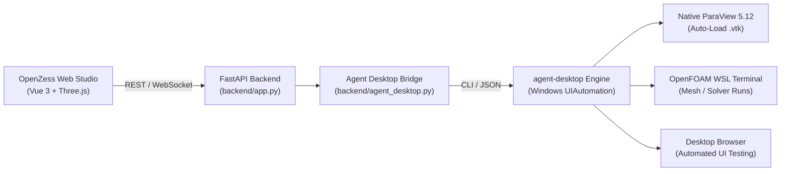

# OpenZess Studio & Vercel Labs `agent-desktop` Integration

This document outlines the architecture and practical usage of the **`vercel-labs/agent-desktop`** computer-use integration in **OpenZess Studio**.

---

## 1. What is `agent-desktop`?

[`vercel-labs/agent-desktop`](https://github.com/vercel-labs/agent-desktop) is an open-source, Rust-based CLI and C library designed to give AI agents native "computer use" capabilities across **Windows, macOS, and Linux**.

### Core Architecture: Accessibility Trees vs. Screenshots
* **Traditional Vision Approaches:** Slower, brittle coordinate clicking based on pixels and screenshots that break with resolution or theme changes.
* **`agent-desktop` Approach:** Interacts directly with the OS accessibility tree (UIAutomation on Windows, AXUIElement on macOS, AT-SPI on Linux) and serializes the application hierarchy into structured JSON.
* **Stable `@ref` Identifiers:** Actionable UI elements (buttons, inputs, menus) are assigned unique, immutable reference IDs (e.g., `@s8f3k2p9:e8`). Actions execute semantically without hijacking the user's physical mouse cursor.

---

## 2. Integration into OpenZess

OpenZess utilizes `agent-desktop` across three core engineering vectors:



1. **Automated Desktop ParaView Post-Processing:**  
   When OpenZess generates VTK files (`.vtk`) or OpenFOAM cases (`system/controlDict`, `0/`, `constant/`), the agent can launch desktop ParaView, load the dataset, apply cutting planes/streamlines, and capture high-resolution figures automatically.
2. **OpenFOAM Terminal & Native Workflow Automation:**  
   Automates running native solvers (`icoFoam`, `simpleFoam`) in Windows Terminal or WSL without manual copy-pasting.
3. **Autonomous End-to-End Testing:**  
   Allows AI testing agents to verify OpenZess Studio UI states, sliders, and WebGL render viewports programmatically.

---

## 3. Available OpenZess REST API Endpoints

The backend (`backend/app.py` & `backend/agent_desktop.py`) exposes the following endpoints:

| Method | Endpoint | Description |
| :--- | :--- | :--- |
| `GET` | `/api/agent-desktop/status` | Returns CLI installation status, platform info, and accessibility permissions |
| `GET` | `/api/agent-desktop/windows` | Lists all visible native application windows (`?app=AppName` to filter) |
| `GET` | `/api/agent-desktop/apps` | Lists running desktop GUI applications |
| `POST` | `/api/agent-desktop/snapshot` | Captures the target application's accessibility tree with `@ref` IDs |
| `POST` | `/api/agent-desktop/click` | Clicks an element via its `@ref` ID (`headed: true` for physical input) |
| `POST` | `/api/agent-desktop/type` | Types text into an element targeted by its `@ref` ID |
| `POST` | `/api/agent-desktop/screenshot` | Captures a PNG screenshot of a specific window |
| `POST` | `/api/agent-desktop/launch-paraview` | Automatically launches native ParaView with an optional `.vtk` case |

---

## 4. CLI Usage Examples

You can also call `agent-desktop` directly from PowerShell:

```powershell
# 1. Check system status and permissions
agent-desktop status

# 2. Inspect running windows
agent-desktop list-windows

# 3. Take an interactive snapshot of a running application
agent-desktop snapshot --app "ParaView" -i --compact

# 4. Click a button using its reference ID
agent-desktop click '@s8f3k2p9:e5'

# 5. Type into a text field
agent-desktop type "reynolds_number" -s '@s8f3k2p9:e2'

# 6. Take a screenshot of the application window
agent-desktop screenshot paraview_render.png --app "ParaView"
```

---

## 5. Verification

To verify that the bridge is active on your running server:
```powershell
Invoke-RestMethod -Uri "http://localhost:8000/api/agent-desktop/status"
```
**Expected Response:**
```json
{
  "installed": true,
  "status": {
    "ok": true,
    "command": "status",
    "data": {
      "permissions": {
        "accessibility": { "state": "granted" }
      },
      "platform": "windows",
      "version": "1.2.0"
    }
  }
}
```

