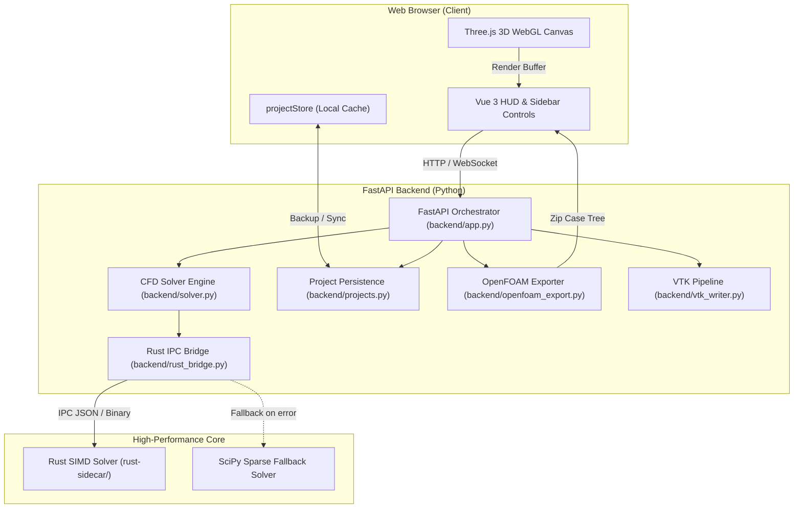

# 🏗️ Architecture & Codebase Map

This document breaks down the structural design of OpenZess Studio, explaining how each folder and file functions and how data travels across the system.

---

## 1. System Architecture Diagram



---

## 2. Directory & File-by-File Reference

```text
openn_fOam/
├── backend/                  # Python FastAPI Backend & Simulation Engines
│   ├── app.py                # Main HTTP/WebSocket router, anti-cache middleware, PINN integration
│   ├── solver.py             # 2D/3D Navier-Stokes numerical solver, fluid database, geometry masks
│   ├── projects.py           # Simulation project save/load REST endpoints
│   ├── openfoam_export.py    # OpenFOAM case file synthesizer (controlDict, fvSchemes, 0/U, etc.)
│   ├── rust_bridge.py        # Subprocess manager communicating with the Rust SIMD sidecar
│   ├── vtk_writer.py         # Structured VTK format generator for ParaView/OpenFOAM
│   └── saved_projects/       # Persistent JSON simulation project snapshots
│
├── frontend/                 # Vue 3 + TypeScript + Three.js Web Client
│   ├── src/
│   │   ├── App.vue           # Main application layout, header, and 3D canvas mount
│   │   ├── components/
│   │   │   ├── SidebarControls.vue # 4-tab control center (Physics, Geometry, Case Tree, History)
│   │   │   ├── CfdThree3D.vue     # Three.js WebGL canvas (streamlines, scalar surfaces, shaders)
│   │   │   ├── HeaderNavbar.vue   # Top navigation, status indicators, solver toggles
│   │   │   ├── ResidualChart.vue  # Real-time convergence plot (U, V, P, k residuals)
│   │   │   └── SettingsModal.vue  # Simulation parameters, solver tolerance, grid resolution
│   │   ├── types/
│   │   │   └── cfd.ts        # TypeScript data contracts (FluidMedium, SolidObstacleSpec, etc.)
│   │   └── utils/
│   │       ├── projectStore.ts # Client-side project manager with localStorage fallback
│   │       └── aiCopilot.ts   # AI CFD Co-Engineer client logic
│   ├── package.json          # Frontend dependencies (Vue 3, Three.js, Lucide icons, Vite)
│   └── vite.config.ts        # Vite build configuration
│
├── rust-sidecar/             # High-Performance SIMD Rust Solver (Optional Acceleration)
│   ├── Cargo.toml            # Rust dependencies (Rayon parallel computation, Serde)
│   └── src/
│       ├── main.rs           # Sidecar entrypoint and IPC interface
│       └── cfd_solver.rs     # Multi-threaded Navier-Stokes numerical kernel
│
├── docs/                     # Project Documentation & Task Protocols
│   ├── handbook/             # Collaborator handbook (Overview, Architecture, Roadmap)
│   ├── tasks/
│   │   ├── PRD.md            # Product Requirements Document & multi-agent task tracker
│   │   └── progress.txt      # Chronological engineering coordination log
│   └── STEP_BY_STEP_CHANGELOG.md # Comprehensive engineering changelog
│
├── LAUNCH_STUDIO.bat         # 1-click Windows launcher script
├── sync_and_launch.py        # Development synchronization and build verification script
└── main.py                   # Root FastAPI launcher with hot-reload support
```

---

## 3. Division of Work: Rust vs. Python

To maintain high simulation speed without sacrificing maintainability, the codebase uses a **two-tier architecture**:

| Feature / Responsibility | Handled By | Rationale |
| :--- | :---: | :--- |
| **Poisson Pressure Equation ($\nabla^2 p = S$)** | **Rust** | Requires hundreds of iterative Gauss-Seidel/SOR cycles per timestep. Rust with Rayon SIMD executes this 20-50x faster than pure Python. |
| **Streamline Particle Tracing** | **Rust** | Tracing thousands of RK4 particles across the grid is heavily CPU-bound and perfectly parallelizable. |
| **High-Level Orchestration & API** | **Python** | FastAPI provides fast, asynchronous REST and WebSocket communication. |
| **OpenFOAM Case Generation** | **Python** | Formatting C++ FoamFiles, dictionary templating, and string manipulation is fastest and most flexible in Python. |
| **SciPy Sparse Fallback Solver** | **Python** | Guarantees that if Rust cannot be compiled on a given host (e.g. strict Windows WDAC or missing Cargo), the simulation still functions smoothly. |
| **3D Rendering & User Interaction** | **Vue 3 / Three.js** | GPU-accelerated rendering directly in the client browser with zero server rendering lag. |
